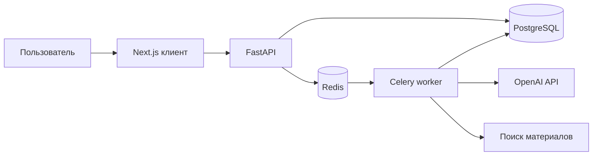
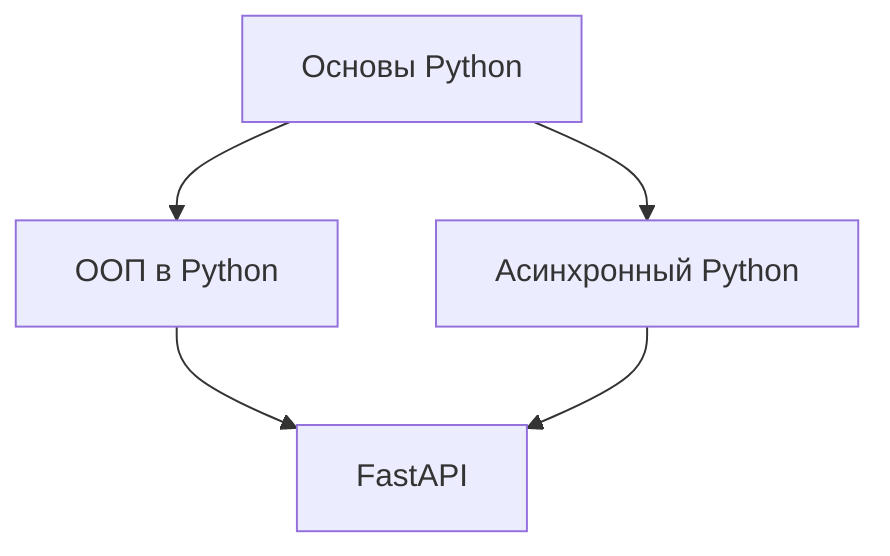

# MindLoom — платформа графов знаний

MindLoom помогает составить план изучения любой темы. Пользователь задаёт предмет, уровень подготовки и язык; приложение строит карту понятий, показывает зависимости между ними, подбирает материалы и помогает повторять изученное. Карта — **направленный ациклический граф (DAG)**: стрелка `A → B` означает, что `A` нужно изучить перед `B`.

Документ ниже пересказывает техническое задание «AI Knowledge Graph Platform» как план разработки. **Сейчас в репозитории реализован только стартовый frontend на Next.js.** Backend, база данных, AI-генерация и описанные API ещё не созданы. Разделы «должен» и «по ТЗ» описывают целевое поведение, а не готовые функции.

## Сценарий пользователя

1. Ввести тему, уровень (`beginner`, `intermediate` или `advanced`) и язык.
2. Дождаться генерации карты. Система создаст понятия и связи, удалит циклы и добавит материалы к каждому понятию.
3. Изучать темы на интерактивном холсте: масштабировать и перемещать карту, открывать карточки узлов, отмечать прогресс.
4. Отвечать на ежедневные вопросы по уже пройденным темам.
5. Скачать карту как заметки Obsidian или диаграмму Mermaid.

## Архитектура по ТЗ

| Компонент | Назначение | Технологии |
| --- | --- | --- |
| Web-клиент | Холст графа, карточка темы, прогресс, тесты и экспорт | Next.js App Router, React, TypeScript, Tailwind CSS, shadcn/ui |
| Граф в браузере | Отображение узлов и автоматическая раскладка | `@xyflow/react`, Dagre или ELK.js |
| Состояние клиента | Локальное состояние и серверные запросы | Zustand, TanStack Query |
| HTTP API | Приём запросов, проверка данных и ответы клиенту | Python 3.11+, FastAPI, Pydantic v2 |
| Фоновый worker | Долгая генерация графа и поиск ресурсов | Celery с Redis как брокером |
| Хранилище | Карты, узлы, связи, прогресс | PostgreSQL, SQLAlchemy 2.0 async, Alembic |
| AI и графовые операции | Структурированная генерация, вопросы, проверка DAG | OpenAI API, NetworkX |
| Поиск материалов | Поиск статей и видео, проверка ссылок | DuckDuckGo или SerpAPI |

В ТЗ для очереди указаны Celery / BullMQ. Для Python backend логичным вариантом является Celery; это пока **предлагаемое решение**, а не установленная часть проекта. Версии Next.js 14+ и React 18+ в ТЗ заданы как минимальные; сейчас установлены Next.js 16.4.3 и React 19.3.0.

### Как взаимодействуют части системы



FastAPI обрабатывает короткие HTTP-запросы. Генерация карты идёт в worker: клиент не ждёт, пока LLM создаст весь граф и поиск проверит каждую ссылку. Redis передаёт фоновую задачу, а результат сохраняется в PostgreSQL. API чтения карты, прогресса и экспорта получает данные из PostgreSQL.

## Как должен работать backend

### 1. Запуск генерации карты

Клиент отправляет запрос:

```http
POST /api/v1/roadmaps/generate
Content-Type: application/json

{
  "topic": "System Design & Distributed Systems",
  "user_level": "intermediate",
  "language": "ru"
}
```

FastAPI валидирует тело запроса через Pydantic, ставит задачу в очередь и сразу возвращает `202 Accepted`:

```json
{ "task_id": "UUID", "status": "processing" }
```

`task_id` нужен клиенту для отслеживания генерации. ТЗ не задаёт endpoint получения статуса задачи, формат ошибок и способ получения готового `roadmap_id`. Эти контракты нужно определить до подключения frontend.

### 2. Структурированная генерация

Worker вызывает OpenAI API со Structured Outputs. Ответ должен соответствовать схеме, в которой есть:

- `title` и `description` карты;
- `nodes`: для каждого узла временный ID, название, краткое описание (`summary`), TL;DR, аналогия и оценка времени изучения в минутах;
- `edges`: пары временных ID исходного и целевого узла.

ТЗ предлагает модели `gpt-4o-mini` и `gpt-4o`. Выбор модели, лимиты запросов и обработку ошибок API нужно закрепить при реализации.

### 3. Очистка и проверка DAG

Worker связывает временные ID, строит `networkx.DiGraph` и проверяет граф. Связь с отсутствующим узлом или узел с повторяющимся ID должен отклоняться валидатором. Для каждого найденного направленного цикла удаляется ребро, создающее возврат, например `B → A` в цикле `A → B → A`. После очистки граф повторно проверяется: циклов быть не должно.

ТЗ описывает удаление циклических рёбер, но не задаёт правило выбора ребра, когда цикл длиннее двух узлов. Его следует сделать детерминированным и проверить тестами, чтобы результат был воспроизводимым.

### 4. Поиск и проверка материалов

Для каждого узла worker выполняет поиск актуальных статей или видео через выбранного провайдера. Кандидатные URL проверяются HTTP-запросом; по ТЗ в карточку попадают первые **две** ссылки с ответом `200`, а название материала извлекается из OpenGraph-метаданных. Ресурсы сохраняются в JSONB с полями `title`, `url`, `type` (`article` или `video`).

На практике ссылки могут позже перестать работать, поэтому критерий «все ссылки отдают 200» проверяется на момент добавления или отдельной повторной проверки. Таймауты, редиректы и ограничения поискового провайдера в ТЗ не определены.

### 5. Сохранение результата

После проверки сервер заменяет временные ID настоящими UUID и **одной транзакцией** сохраняет карту, узлы и связи в PostgreSQL. При ошибке сохранения транзакция откатывается, чтобы не оставлять неполную карту. Для доступа к базе используется асинхронный SQLAlchemy `AsyncSession`; изменения схемы оформляются миграциями Alembic.

Целевое время генерации MVP по ТЗ — **5–15 секунд**. Это критерий приёмки, который предстоит измерить; текущее приложение генерацию не выполняет.

## Данные PostgreSQL

ТЗ задаёт четыре таблицы. Ниже основные поля и ограничения без копирования длинного SQL-блока.

| Таблица | Поля | Связи и ограничения |
| --- | --- | --- |
| `roadmaps` | `id` UUID, `title`, `description`, `target_audience` (по умолчанию `intermediate`), `language` (по умолчанию `ru`), `is_public`, `forked_from_id`, `created_at`, `updated_at` | `forked_from_id` указывает на исходную карту; при её удалении становится `NULL` |
| `nodes` | `id` UUID, `roadmap_id`, `title`, `summary`, `tldr`, `analogy`, `content_markdown`, `resources` JSONB, `estimated_minutes` (по умолчанию 30), `created_at` | Каждый узел принадлежит карте; при удалении карты узлы удаляются |
| `edges` | `id` UUID, `roadmap_id`, `source_node_id`, `target_node_id`, `relation_type` (по умолчанию `prerequisite`) | Уникальная пара `source_node_id` + `target_node_id`; узлы и карта связаны внешними ключами |
| `user_node_progress` | `user_id`, `node_id`, `status`, `completed_at`, `next_review_at`, `review_interval` (по умолчанию 1), `ease_factor` (по умолчанию 2.5) | Составной первичный ключ `user_id` + `node_id`; запись прогресса удаляется вместе с узлом |

Допустимые состояния прогресса по ТЗ: `not_started`, `in_progress`, `completed`. Типы связи: `prerequisite`, `next_step`, `related`. Проверка DAG и семантика `related` требуют согласования: если «связанная тема» не означает зависимость, её не следует считать пререквизитом при блокировке узлов.

В схеме есть `user_id`, но нет таблицы пользователей, авторизации и правил доступа к публичным или личным картам. Это открытая часть ТЗ, а не реализованная возможность.

## Повторение и ежедневные тесты

1. Когда пользователь завершает узел через `POST /api/v1/progress/complete`, backend ставит `status = completed`, записывает `completed_at` и назначает `next_review_at = NOW() + 1 день`.
2. `GET /api/v1/quiz/daily` выбирает завершённые узлы этого пользователя, у которых `next_review_at <= NOW()`.
3. Для каждого выбранного узла LLM генерирует один вопрос с **четырьмя** вариантами ответа на основе названия и описания узла.
4. `POST /api/v1/quiz/submit` проверяет ответ. При верном ответе новый интервал равен `review_interval × ease_factor`, а следующий повтор назначается через этот интервал. При ошибке интервал сбрасывается до 1 дня, `ease_factor = max(1.3, ease_factor - 0.2)`.

В ТЗ этот механизм назван SM-2, но приведена **упрощённая формула** без оценки качества ответа по шкале SM-2. При реализации нужно выбрать правила округления интервала, хранение вопросов и правильных ответов, а также защиту от повторной отправки одного ответа.

## Экспорт

### Obsidian

`GET /api/v1/roadmaps/{id}/export/obsidian` возвращает ZIP. Внутри — отдельный Markdown-файл для каждого узла. Файл содержит TL;DR, аналогию, материалы и связи с другими темами в формате `[[Название темы]]`. Направление `Source → Target` должно быть отражено одинаково во всех заметках, чтобы зависимости читались правильно.

### Mermaid

`GET /api/v1/roadmaps/{id}/export/mermaid` возвращает текст диаграммы. Например:



При реализации нужно экранировать названия узлов и делать устойчивые ID, чтобы экспорт работал и с кавычками, и с одинаковыми названиями тем.

## API по ТЗ

| Метод и путь | Что делает |
| --- | --- |
| `POST /api/v1/roadmaps/generate` | Запускает фоновую генерацию и возвращает `202`, `task_id`, `status` |
| `GET /api/v1/roadmaps/{id}` | Отдаёт карту с узлами и связями для холста; этот маршрут указан в разделе frontend ТЗ |
| `POST /api/v1/progress/complete` | Завершает изучение узла и назначает первый повтор |
| `GET /api/v1/quiz/daily` | Отдаёт вопросы по темам, срок повторения которых наступил |
| `POST /api/v1/quiz/submit` | Принимает ответ и обновляет параметры повторения |
| `POST /api/v1/chat/node-context` | Отправляет вопрос AI-тьютору с контекстом выбранного узла |
| `GET /api/v1/roadmaps/{id}/export/obsidian` | Скачивает ZIP с заметками |
| `GET /api/v1/roadmaps/{id}/export/mermaid` | Отдаёт Mermaid-текст |

ТЗ не задаёт тела большинства запросов и ответов, маршрут статуса фоновой задачи, пагинацию, авторизацию и коды ошибок. До разработки клиентских запросов для них нужны отдельные схемы Pydantic и примеры ответов.

## Интерфейс по ТЗ

- **Холст:** `@xyflow/react` рисует узлы и направленные анимированные связи. Пользователь может масштабировать граф и перетаскивать узлы.
- **Карточка узла:** иконка типа материала, название темы, оценка времени и состояние. `completed` отмечается зелёной галочкой, `in_progress` — синей обводкой, недоступный узел — замком.
- **Автораскладка:** кнопка пересчитывает координаты через Dagre или ELK.js, сверху вниз либо слева направо.
- **Боковая панель:** открывается при нажатии на узел. Вкладки: «Обзор» (TL;DR, конспект, аналогия), «Ресурсы» (ссылки и их метаданные), «AI-тьютор» (чат в контексте только выбранного узла).
- **Запросы и состояние:** TanStack Query получает данные карты и прогресса от API, Zustand может хранить состояние холста и открытой панели.

## Состояние репозитория и запуск

Сейчас установлен Next.js App Router с TypeScript, Tailwind CSS и ESLint. Стартовая страница показывает описание MindLoom. В `package.json` пока **нет** FastAPI, Redis, PostgreSQL, React Flow, Dagre, Zustand, TanStack Query и shadcn/ui; их подключение относится к следующим этапам.

Нужен Node.js 20.9 или новее и npm. В корне проекта:

```bash
npm install
npm run dev
```

Откройте `http://localhost:3000`. Проверка текущего frontend: `npm run build` и `npm run lint`.

Команд запуска backend и переменных окружения пока нет, потому что backend не создан. Когда он появится, понадобятся PostgreSQL, Redis, ключ OpenAI и настройки поискового провайдера. Секреты следует хранить вне репозитория.

## Порядок реализации

1. Создать FastAPI-приложение, SQLAlchemy-модели четырёх таблиц, подключение PostgreSQL и миграции Alembic.
2. Добавить Redis и worker, Pydantic-схемы структурированного ответа LLM, проверку и очистку DAG.
3. Добавить поиск и проверку материалов, атомарное сохранение карты, статусы и ошибки фоновой задачи.
4. Реализовать чтение карты и холст React Flow с автоматической раскладкой и панелью узла.
5. Добавить прогресс, ежедневные вопросы, обновление интервалов и AI-тьютора.
6. Реализовать экспорт Obsidian и Mermaid и проверить критерии MVP.

## Критерии готовности MVP из ТЗ

- Генерация карты по произвольной теме занимает целевые 5–15 секунд.
- Сохранённый граф не содержит направленных циклов.
- Ссылки в карточках узлов при проверке возвращают HTTP `200`.
- Холст поддерживает масштабирование, перетаскивание и автоматическую раскладку.
- Экспорт Obsidian скачивается как ZIP с отдельными заметками и связями `[[WikiLinks]]`.

Эти критерии относятся к будущему MVP. Текущая проверка репозитория подтверждает только работоспособность стартового Next.js приложения.
